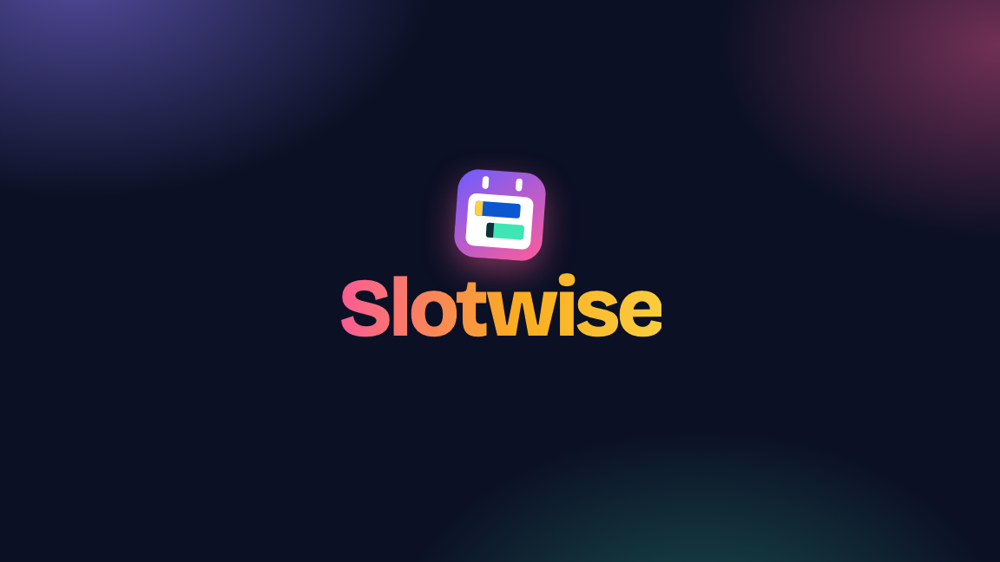

# Slotwise

**Jira knows what you promised. Your calendar knows where your time goes. They never meet.**

Slotwise puts your Jira tickets on your Google Calendar, so the work you planned is as visible as your meetings.

[](https://github.com/MelihCagdas/slotwise/releases/download/v0.3.1/slotwise-sales.mp4)

▶ [Watch the 54-second video](https://github.com/MelihCagdas/slotwise/releases/download/v0.3.1/slotwise-sales.mp4) · [See the real screen recording](https://github.com/MelihCagdas/slotwise/releases/download/v0.3.1/slotwise-screen-recording.mp4)

## The problem

On a remote team, nobody sees you are heads-down.

- An empty slot on your calendar looks free, even when you planned real work for it.
- So meetings pile on, and the ticket slips again.
- Your teammates in other time zones ask "what are you on this week?" because the answer lives in a different tool.

## What Slotwise does

- **Your tickets, beside your calendar.** A panel in Google Calendar lists your Jira tickets, coloured by status.
- **Drag one onto a slot.** It becomes a normal calendar event that you can stretch, move and share.
- **Or press Auto-plan.** Your tickets are laid out across the week: work in progress first, sized by story points.
- **Everyone can see it.** The events show as busy, so people booking you see the time is taken, and what for.

**Transparency first. Respect for time. Real focus.**

No token. No server. Free and open source. It only reads Jira, from your own browser.

## Two ways to use it

| | Drag and drop | Automatic plan |
|---|---|---|
| What it is | A panel of your Jira tickets beside Google Calendar | A script that lays out your whole sprint for you |
| You do | Search, drag a ticket onto a day or an hour | Nothing, it refreshes every morning |
| Result | An ordinary calendar event you can move, stretch or invite people to | All-day bars in a separate "Jira plan" calendar |
| Setup | A browser extension, no token | A pasted script and a Jira API token |

Use either, or both.

## Drag and drop

The extension adds a **Slotwise** panel to Google Calendar in your browser, listing your Jira tickets.

- **Your tickets, in one list.** This sprint first, then your other open tickets.
- **Search.** Type to filter your own tickets. Three letters or more also searches the rest of Jira, and a ticket number such as `APP-12` finds that ticket.
- **Drag onto the calendar.** Drop on an hour in week or day view for a one-hour event at that time. Drop on the strip under the date, or on a day in month view, for an all-day event.
- **Colours by status.** Grey for to do, blue for in progress, amber for in review or QA.
- **Auto-plan my tickets.** One button spreads the tickets that are still in the panel across the remaining days of the sprint (or the coming working days, if you do not use sprints): work in progress first, then board order, sized by story points. Tickets you already placed are left alone and get a tick in the panel.
- **It is a normal event.** The title is the ticket number and name, and the description links to the ticket. Move it, stretch it across hours or days, change its colour, invite people. It shows as busy, so anyone booking you sees the time is taken.
- **No token.** It uses the Jira sign-in your browser already has.

### Customise

The **Customise** link at the bottom of the panel sets:

| Setting | Default | What it does |
|---|---|---|
| Auto-plan uses | My current sprint | Or all your open tickets, for teams that do not work in sprints. |
| Working days | Monday to Friday | The days tickets are spread across. |
| Statuses that go first | In Progress | Tickets in these statuses are placed first. |
| Statuses to leave out | none | Tickets in these statuses are not auto-planned, for example a QA status. |
| With no sprint, spread over | 10 working days | How far ahead to plan when there is no sprint. |
| A dropped ticket lasts | 1 hour | 30 minutes, 1 hour, 1.5 hours or 2 hours. |

### Try it without Jira

Type `demo` as the Jira address to load sample tickets. Everything else works as normal, so you can see it before connecting your own Jira.

### Install the extension

It is not in the Chrome Web Store yet, so it is loaded by hand. This takes about a minute and works in Chrome and Edge.

1. Download this repository: **Code**, then **Download ZIP**, and unzip it.
2. Open `chrome://extensions` in the browser.
3. Switch on **Developer mode** (top right).
4. Click **Load unpacked** and choose the `extension` folder.
5. Open Google Calendar. In the **Slotwise** panel on the right, enter your Jira address, for example `your-team.atlassian.net`.

Make sure you are signed in to Jira in the same browser.

### What happens on a drop

The extension opens Google Calendar's own new-event page with the ticket filled in, saves it, and returns you to the week you were looking at. This takes a few seconds. Untick **Save a dropped ticket straight away** in the panel if you would rather check each event before it is saved.

**Auto-plan my tickets** does the same for each ticket in turn, about ten seconds a ticket. Do not type in the Calendar tab while it runs: Google Calendar treats single keys as shortcuts and will interrupt it. Pressing the button again later places only tickets that are not on the calendar yet.

The extension asks for two permissions: to run on `calendar.google.com`, and to read from `atlassian.net`. It only reads Jira. It sends nothing anywhere else.

## Automatic plan

The script reads your sprint and draws it for you. The rest of this page from **What you get** to **Remove it** describes the script.

## What you get

- **Your sprint as a plan.** Every open ticket assigned to you becomes an all-day bar on the days it should take, sized by its story points.
- **In-progress work first.** What you have started is placed on today and the next days. The rest follows in board order.
- **The next sprints too.** Tickets already placed in coming sprints are drawn in grey in the weeks after.
- **Always current.** It refreshes every morning. Finish a ticket and its bar goes away; move one into the sprint and it appears.
- **Nothing to tune.** There is no "hours per point" setting. It works whether your team treats a point as an hour or a day.
- **Safe by design.** It reads Jira and never changes it. It writes to its own calendar, called **Jira plan**, and never touches your events. Hide it with one click, or remove it completely with one command.
- **Private.** It runs inside your own Google account. Your data goes from Jira to your calendar and nowhere else.

## Set up in 5 minutes

You need a Jira Cloud account and a Google account.

1. **Create a Jira API token.** Go to <https://id.atlassian.com/manage-profile/security/api-tokens>, choose **Create API token** (the plain one, not "with scopes"), and copy it.
2. **Create the script.** Go to <https://script.google.com>, choose **New project**, delete the sample code, and paste in the whole of [`Code.gs`](Code.gs). Save.
3. **Add your details.** Open **Project Settings** (the gear icon), scroll to **Script Properties**, and add:

   | Property | Value |
   |---|---|
   | `JIRA_SITE` | Your Jira address, for example `your-team.atlassian.net` |
   | `JIRA_EMAIL` | The email you sign in to Jira with |
   | `JIRA_TOKEN` | The token from step 1 |

4. **Check the time zone.** Still in **Project Settings**, make sure **Time zone** is your own. The script uses it to decide what "today" is.
5. **Run it once.** Back in the editor, pick `setup` in the function list and press **Run**. Google asks for permission to manage your calendars and to contact Jira. Because this is your own script, Google may first show "Google hasn't verified this app": choose **Advanced**, then **Go to (your project name)**, then approve.

Open Google Calendar. A new calendar called **Jira plan** now shows your tickets. It refreshes by itself every morning. To refresh at any time, run `sync`.

A one-click version with no token and no script to paste is planned. See [Roadmap](#roadmap).

## How it decides

- **Which tickets.** Tickets assigned to you, in an open sprint, that are not done.
- **Order.** Tickets in the status "In Progress" come first. Next come other started work, such as tickets in review. Last come tickets you have not started. Inside each group the order is your board's rank.
- **Size.** Story points, when your tickets have them. If none do, the original time estimate. If there is neither, every ticket counts the same. A ticket with no size gets the average of the others.
- **Spread.** Each ticket gets a share of the remaining working days equal to its share of the total size, rounded to whole days. A large ticket spans several days. Small tickets share a day. Everything always fits inside the sprint.
- **Days.** Monday to Friday. Days where you have an out-of-office event covering 09:00 to 17:00 are skipped.
- **Future sprints.** Tickets in a coming sprint are drawn in grey after the current sprint. Jira only gives a sprint its dates when it starts, so until then the script assumes each coming sprint follows straight on and lasts as many working days as the current one. The bar's description says "dates estimated". It corrects itself once the sprint starts.
- **No sprint.** If you have no open or coming sprint, for example on a Kanban board, it takes your first 20 open tickets and spreads them over the next 10 working days.

When you finish a ticket, its bar goes away at the next refresh and the remaining tickets spread out to fill the days. Each morning it redraws from today forward. Earlier days are left as they were, so you keep a record of what was planned. It only ever changes bars it created itself.

Colours: dark green is work in progress, light green is the rest of the current sprint, grey is a future sprint.

## Optional settings

Add any of these as Script Properties. None are required.

| Property | Default | What it does |
|---|---|---|
| `ACTIVE_STATUSES` | `In Progress` | Status names that go first. Separate several with commas. |
| `SKIP_STATUSES` | none | Status names to leave out, for example `Ready for QA`. |
| `WORKING_DAYS` | `1,2,3,4,5` | Working days as numbers, where 0 is Sunday and 6 is Saturday. |
| `RUN_HOUR` | `7` | Hour of the day for the daily refresh. Run `setup` again after changing it. |
| `POINTS_FIELD` | found automatically | The Jira field ID for story points, for example `customfield_10016`. Only needed if the wrong field is picked. |

## Remove it

Run `remove`. It deletes the daily timer and the **Jira plan** calendar. Nothing else in your calendar is touched. You can then delete the script project and revoke the Jira token.

## Privacy

The script runs inside your own Google account. Your Jira token is stored in your script's properties and is sent only to your Jira site. No data goes anywhere else, and there is no server run by this project.

## Limits today

- Jira Cloud only. Jira Server and Data Center are not supported.
- Google Calendar only.
- Shows your own tickets only.
- It plans whole days. It does not block hours around your meetings, and the bars are marked "free", so they do not stop anyone booking you.
- The script needs a Jira API token and a pasted script.
- The extension works in Chrome and Edge on a computer, not on a phone. It is loaded by hand until it is in the Chrome Web Store.
- The extension depends on how Google Calendar's page is built. If Google changes the page, dropping may stop working until the extension is updated.

## Roadmap

These are planned, not built:

- **Chrome Web Store listing.** Install the extension in one click.
- **Instant drops and a plan that keeps itself up to date.** The code for a direct Google Calendar connection is in the extension but switched off until the extension is registered with Google.
- **One-click automatic plan.** A Google Calendar add-on: install it, sign in to Jira, done. No token, no script.
- **Team view.** See a teammate's plan next to your own.
- **More calendars.** Outlook after Google.

Ideas and pull requests are welcome. Open an issue to discuss anything larger first.

## If something goes wrong

Open **Executions** in the script editor to see the last run. The message says what to check:

- "Check JIRA_EMAIL and JIRA_TOKEN": the email or token is wrong, or the token has expired.
- "Check JIRA_SITE": the Jira address is wrong.
- "Missing Script Properties": one of the three required values is not set.

Jira is always read before the calendar is touched, so when Jira cannot be read the calendar is left exactly as it was.

## Development

The planning logic of the script and the drop logic of the extension (`extension/lib.js`) are plain JavaScript with no browser or Google calls, so they can be tested with Node 22 or later:

```
npm test
```

[`DESIGN.md`](DESIGN.md) explains the design and the choices behind it.

## Licence

MIT. See [`LICENSE`](LICENSE).
