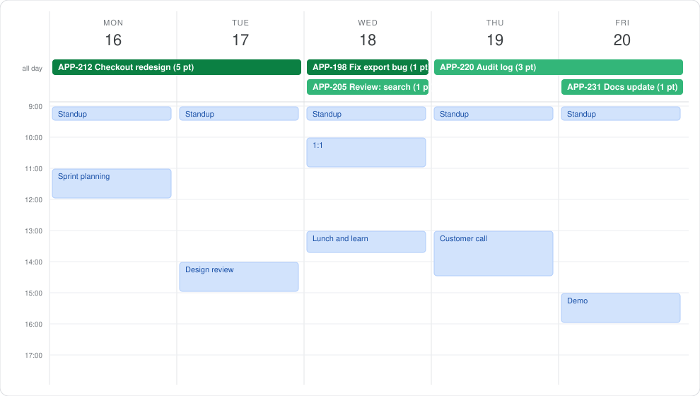

# Jira Sprint Calendar

**Your sprint, on your calendar.** Your Jira tickets appear in Google Calendar, laid out across the days of the sprint, next to your meetings. No app to learn, no board to keep open.



## Why

Remote teams run on two tools that never meet. Jira knows what you committed to. Your calendar knows where your time goes. Nobody sees both at once, so the same things keep happening:

- A sprint looks fine on the board and impossible on the calendar.
- A teammate books a meeting on the day you planned to finish a ticket, because they had no way to know.
- "What are you working on this week?" gets asked in every standup.

Jira Sprint Calendar puts the plan where people already look. Open your calendar and you see what you are delivering each day, this sprint and the next.

## What you get

- **Your sprint as a plan.** Every open ticket assigned to you becomes an all-day bar on the days it should take, sized by its story points.
- **In-progress work first.** What you have started is placed on today and the next days. The rest follows in board order.
- **The next sprints too.** Tickets already placed in coming sprints are drawn in grey in the weeks after.
- **Always current.** It refreshes every morning. Finish a ticket and its bar goes away; move one into the sprint and it appears.
- **Nothing to tune.** There is no "hours per point" setting. It works whether your team treats a point as an hour or a day.
- **Safe by design.** It reads Jira and never changes it. It writes to its own calendar, called **Jira plan**, and never touches your events. Hide it with one click, or remove it completely with one command.
- **Private.** It runs inside your own Google account. Your data goes from Jira to your calendar and nowhere else.

## Set up in 5 minutes

You need a Jira Cloud account and a Google account.

1. **Create a Jira API token.** Go to <https://id.atlassian.com/manage-profile/security/api-tokens>, choose **Create API token** (the plain one, not "with scopes"), and copy it.
2. **Create the script.** Go to <https://script.google.com>, choose **New project**, delete the sample code, and paste in the whole of [`Code.gs`](Code.gs). Save.
3. **Add your details.** Open **Project Settings** (the gear icon), scroll to **Script Properties**, and add:

   | Property | Value |
   |---|---|
   | `JIRA_SITE` | Your Jira address, for example `your-team.atlassian.net` |
   | `JIRA_EMAIL` | The email you sign in to Jira with |
   | `JIRA_TOKEN` | The token from step 1 |

4. **Check the time zone.** Still in **Project Settings**, make sure **Time zone** is your own. The script uses it to decide what "today" is.
5. **Run it once.** Back in the editor, pick `setup` in the function list and press **Run**. Google asks for permission to manage your calendars and to contact Jira. Because this is your own script, Google may first show "Google hasn't verified this app": choose **Advanced**, then **Go to (your project name)**, then approve.

Open Google Calendar. A new calendar called **Jira plan** now shows your tickets. It refreshes by itself every morning. To refresh at any time, run `sync`.

A one-click version with no token and no script to paste is planned. See [Roadmap](#roadmap).

## How it decides

- **Which tickets.** Tickets assigned to you, in an open sprint, that are not done.
- **Order.** Tickets in the status "In Progress" come first. Next come other started work, such as tickets in review. Last come tickets you have not started. Inside each group the order is your board's rank.
- **Size.** Story points, when your tickets have them. If none do, the original time estimate. If there is neither, every ticket counts the same. A ticket with no size gets the average of the others.
- **Spread.** Each ticket gets a share of the remaining working days equal to its share of the total size, rounded to whole days. A large ticket spans several days. Small tickets share a day. Everything always fits inside the sprint.
- **Days.** Monday to Friday. Days where you have an out-of-office event covering 09:00 to 17:00 are skipped.
- **Future sprints.** Tickets in a coming sprint are drawn in grey after the current sprint. Jira only gives a sprint its dates when it starts, so until then the script assumes each coming sprint follows straight on and lasts as many working days as the current one. The bar's description says "dates estimated". It corrects itself once the sprint starts.
- **No sprint.** If you have no open or coming sprint, for example on a Kanban board, it takes your first 20 open tickets and spreads them over the next 10 working days.

When you finish a ticket, its bar goes away at the next refresh and the remaining tickets spread out to fill the days. Each morning it redraws from today forward. Earlier days are left as they were, so you keep a record of what was planned. It only ever changes bars it created itself.

Colours: dark green is work in progress, light green is the rest of the current sprint, grey is a future sprint.

## Optional settings

Add any of these as Script Properties. None are required.

| Property | Default | What it does |
|---|---|---|
| `ACTIVE_STATUSES` | `In Progress` | Status names that go first. Separate several with commas. |
| `SKIP_STATUSES` | none | Status names to leave out, for example `Ready for QA`. |
| `WORKING_DAYS` | `1,2,3,4,5` | Working days as numbers, where 0 is Sunday and 6 is Saturday. |
| `RUN_HOUR` | `7` | Hour of the day for the daily refresh. Run `setup` again after changing it. |
| `POINTS_FIELD` | found automatically | The Jira field ID for story points, for example `customfield_10016`. Only needed if the wrong field is picked. |

## Remove it

Run `remove`. It deletes the daily timer and the **Jira plan** calendar. Nothing else in your calendar is touched. You can then delete the script project and revoke the Jira token.

## Privacy

The script runs inside your own Google account. Your Jira token is stored in your script's properties and is sent only to your Jira site. No data goes anywhere else, and there is no server run by this project.

## Limits today

- Jira Cloud only. Jira Server and Data Center are not supported.
- Google Calendar only.
- Shows your own tickets only.
- It plans whole days. It does not block hours around your meetings, and the bars are marked "free", so they do not stop anyone booking you.
- Setup needs a Jira API token and a pasted script.

## Roadmap

These are planned, not built:

- **One-click install.** A Google Calendar add-on: install it, sign in to Jira, done. No token, no script.
- **A ticket list inside Calendar.** A side panel with your sprint tickets, to place one on a day yourself.
- **Focus blocks.** Optionally hold real time for a ticket, so people booking you see that the time is taken and what for.
- **Team view.** See a teammate's plan next to your own.
- **More calendars.** Outlook after Google.

Ideas and pull requests are welcome. Open an issue to discuss anything larger first.

## If something goes wrong

Open **Executions** in the script editor to see the last run. The message says what to check:

- "Check JIRA_EMAIL and JIRA_TOKEN": the email or token is wrong, or the token has expired.
- "Check JIRA_SITE": the Jira address is wrong.
- "Missing Script Properties": one of the three required values is not set.

Jira is always read before the calendar is touched, so when Jira cannot be read the calendar is left exactly as it was.

## Development

The planning logic is plain JavaScript with no Google calls, so it can be tested with Node 22 or later:

```
npm test
```

[`DESIGN.md`](DESIGN.md) explains the design and the choices behind it.

## Licence

MIT. See [`LICENSE`](LICENSE).
