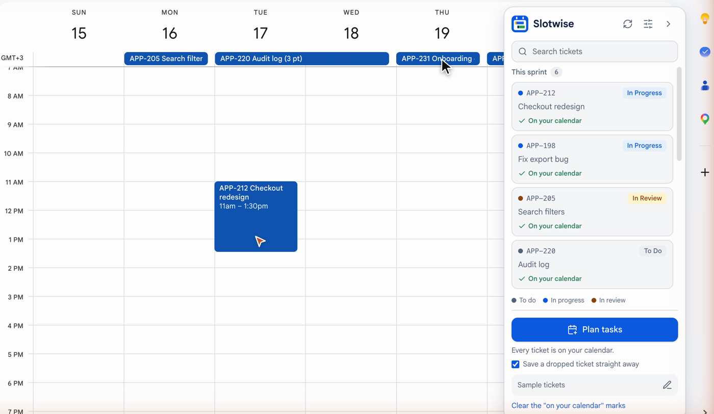

# Slotwise

**Jira knows what you promised. Your calendar knows where your time goes. They never meet.**

Slotwise puts your Jira tickets on your Google Calendar, so the work you planned is as visible as your meetings.

[](https://github.com/MelihCagdas/slotwise/releases/download/v0.6.0/slotwise-sales.mp4)

▶ [Watch the video](https://github.com/MelihCagdas/slotwise/releases/download/v0.6.0/slotwise-sales.mp4) · [See the real screen recording](https://github.com/MelihCagdas/slotwise/releases/download/v0.6.0/slotwise-screen-recording.mp4)

## The problem

On a remote team, nobody sees you are heads-down.

- An empty slot on your calendar looks free, even when you planned real work for it.
- So meetings pile on, and the ticket slips again.
- Your teammates in other time zones ask "what are you on this week?" because the answer lives in a different tool.

## What Slotwise does



Slotwise does your calendar work for you, so you keep your focus.

- **It plans your week.** One click, and every sprint ticket is on your calendar, work in progress first, sized by story points. You never copy a ticket into a calendar again.
- **It guards your time.** A ticket you drop on an hour is a real block, so an empty slot stops looking free and meetings stop landing on your work.
- **It pushes back for you.** When someone books over a ticket anyway, it answers "Maybe" and tells them what you had planned. You do not write that message.
- **It keeps itself up to date.** Move, finish or resize a ticket in Jira and your calendar follows.
- **It tells your team what you are on.** Across time zones, anyone can open your calendar and see it, without asking you.

**Transparency first. Respect for time. Real focus.**

No token. No server. Free and open source. It only reads Jira, from your own browser.

## Install

You need Chrome or Edge on a computer, a Jira Cloud account, and Google Calendar.

1. **Download it.** On this page press **Code**, then **Download ZIP**, and unzip the file.
2. **Open the extensions page.** Type `chrome://extensions` in the address bar.
3. **Switch on Developer mode.** It is the switch at the top right.
4. **Load it.** Press **Load unpacked** and choose the `extension` folder inside the unzipped folder.
5. **Open Google Calendar.** The **Slotwise** panel is on the right. Type your Jira address, for example `your-team.atlassian.net`, and press **Show my tickets**.

That is all. Your tickets are in the panel. Make sure you are signed in to Jira in the same browser.

- **No Jira to hand?** Type `demo` as the address to try it with sample tickets.
- **Want the automatic parts?** Press **Connect Google Calendar** at the bottom of the panel. See [Connect Google Calendar](#connect-google-calendar).

It is loaded by hand because it is not in the Chrome Web Store yet.

## Using it

- **Your tickets, in one list.** This sprint first, then your other open tickets, coloured by status: grey for to do, blue for in progress, amber for in review or QA.
- **Search.** Type to filter your own tickets. Three letters or more also searches the rest of Jira, and a ticket number such as `APP-12` finds that ticket.
- **Drag onto the calendar.** Drop on an hour in week or day view for an event at that time. Drop on the strip under the date, or on a day in month view, for an all-day event.
- **It is a normal event.** The title is the ticket number and name, and the description links to the ticket. Move it, stretch it across hours or days, change its colour, invite people.
- **Plan tasks.** One button spreads the tickets that are still in the panel across the remaining days of the sprint, or the coming working days if you do not use sprints. Tickets you already placed are left alone and get a tick in the panel.
- **Fold it away.** The arrow at the top of the panel folds it into a small tab with the logo. Click the tab to bring it back.

## Connect Google Calendar

The panel works without this. Connecting adds three things, with nothing to switch on afterwards:

- **Instant drops.** A dropped ticket is on the calendar in under a second, with no page change.
- **A plan that follows Jira.** After you press **Plan tasks** once, the plan is kept up to date while Chrome is running.
- **Heads-ups.** Every two minutes, and whenever you open Calendar, Slotwise looks at the invitations you have not answered in the next two weeks. One that overlaps a ticket placed on an hour is answered "Maybe" with a note, once: "Heads-up: I have APP-12 Fix login planned 10:00 to 11:30 then. I can still join if it is needed." Google emails that to the person who invited you. You can still change the answer to Yes or No. All-day plan bars never count as a clash.

Press **Connect Google Calendar** at the bottom of the panel and choose **Allow**. Each of the two automatic features has an off switch in **Customise**, under "Done for you". **Disconnect Google Calendar** is there too: your events stay, and Slotwise stops changing your calendar by itself.

Two limits to know:

- Until Google has reviewed the app, connecting only works for Google accounts on the project's test-user list, and Google shows an "unverified app" warning first. Everyone else can use the panel, drag and drop and Plan tasks without connecting.
- Google only puts an invitation on your calendar when it knows the sender (a colleague, a contact, someone you have written to). An invitation it holds back cannot clash with anything, so no heads-up is sent for it.

## Customise

The **Customise** button (the sliders icon at the top of the panel) sets:

| Setting | Default | What it does |
|---|---|---|
| Plan tasks uses | My current sprint | Or all your open tickets, for teams that do not work in sprints. |
| Working days | Monday to Friday | The days tickets are spread across. |
| Statuses that go first | In Progress | Tickets in these statuses are placed first. |
| Statuses to leave out | none | Tickets in these statuses are not planned, for example a QA status. |
| With no sprint, spread over | 10 working days | How far ahead to plan when there is no sprint. |
| A dropped ticket lasts | 1 hour | 30 minutes, 1 hour, 1.5 hours or 2 hours. |

## How Plan tasks decides

- **Which tickets.** Tickets assigned to you, in an open sprint, that are not done and not on your calendar yet.
- **Order.** Tickets in the status "In Progress" come first. Next come other started work, such as tickets in review. Last come tickets you have not started. Inside each group the order is your board's rank.
- **Size.** Story points, when your tickets have them. If none do, the original time estimate. If there is neither, every ticket counts the same. A ticket with no size gets the average of the others.
- **Spread.** Each ticket gets a share of the remaining working days equal to its share of the total size, rounded to whole days. A large ticket spans several days. Small tickets share a day. Everything fits inside the sprint.
- **Future sprints.** Tickets in a coming sprint are placed in the weeks after the current one. Jira only gives a sprint its dates when it starts, so until then each coming sprint is assumed to follow straight on.
- **No sprint.** On a Kanban board, for example, it takes your first 20 open tickets and spreads them over the next 10 working days.

## What happens behind a drop

Without the Google connection, the extension opens Google Calendar's own new-event page with the ticket filled in, saves it, and returns you to the view you were in. A small card covers the page while it does this, so it takes a few seconds but nothing jumps. Untick **Save a dropped ticket straight away** in the panel if you would rather check each event before it is saved.

**Plan tasks** does the same for each ticket in turn. A planning screen covers the page and shows each ticket being ticked off; press **Stop** on it to stop. What is already placed stays. Keep the tab open and do not type in it while it runs.

## Privacy and permissions

- The extension asks to run on `calendar.google.com` and to read from `atlassian.net`. It only reads Jira, using the sign-in your browser already has.
- If you connect Google Calendar it also asks Google for permission to see and change your events. It creates events for your tickets, keeps its own **Jira plan** calendar, and answers "Maybe" with the heads-up note on an invitation that lands on a ticket. It changes nothing else.
- There is no server run by this project. Nothing is sent anywhere except to your own Jira and your own Google Calendar.

## Limits today

- Jira Cloud only. Jira Server and Data Center are not supported.
- Google Calendar only, in Chrome or Edge on a computer, not on a phone.
- It shows your own tickets only.
- **Plan tasks** makes all-day bars, which Google Calendar counts as free time. Only a ticket dropped on an hour blocks that hour.
- It is loaded by hand until it is in the Chrome Web Store.
- It depends on how Google Calendar's page is built. If Google changes the page, dropping may stop working until the extension is updated.

## Slotwise for teams

A version for whole teams is planned: a team view of who is on what, meeting load against the sprint, and Outlook as well as Google Calendar.

It is not built yet. [Join the waiting list](https://github.com/MelihCagdas/slotwise/issues/1) with a thumbs-up or a comment.

## Roadmap

These are planned, not built:

- **Chrome Web Store listing.** Install in one click.
- **Google review.** The Google connection works for listed test users today. After Google has reviewed the app it will work for everyone, without the warning.
- **Team view.** See a teammate's plan next to your own.
- **More calendars.** Outlook after Google.

Ideas and pull requests are welcome. Open an issue to discuss anything larger first.

## If something goes wrong

- "You are not signed in to Jira in this browser": open Jira in the same browser, sign in, then press **Refresh** (the arrows icon at the top of the panel).
- "Slotwise was updated. Reload this page to carry on": the extension was updated or reloaded while Calendar was open. Reload the Calendar tab.
- "Check the event, then press Save": Slotwise opened the new-event page but did not press Save itself. Press Save, or close the page to leave the ticket in the list.
- A ticket shows "On your calendar" after you deleted its event: press **Clear the "on your calendar" marks** at the bottom of the panel.

## Development

The planning rules and the drop logic are plain JavaScript with no browser or Google calls, so they can be tested with Node 22 or later:

```
npm test
```

The browser tests load the real extension into Chromium and use it against a stand-in Google Calendar and a stand-in Jira (`test/e2e/harness.js`), so nothing leaves your computer and no account is needed:

```
npm install
npx playwright install chromium
npm run test:e2e
```

[`DESIGN.md`](DESIGN.md) explains the design and the choices behind it. An older script version, which draws the plan every morning without a browser, is described in [`docs/script.md`](docs/script.md).

## Licence

MIT. See [`LICENSE`](LICENSE).
